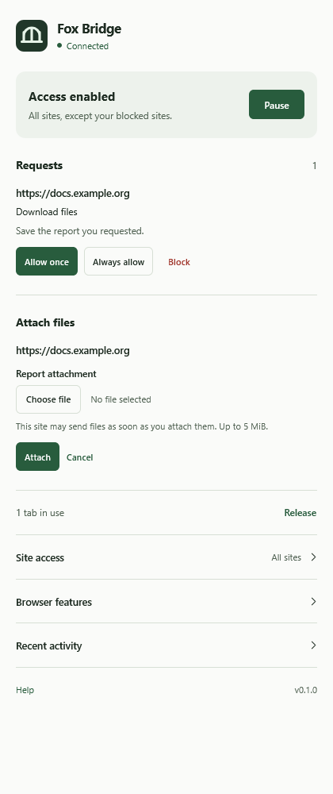

# Firefox Bridge

<samp>Local Firefox control and debugging through the Model Context Protocol.</samp>

Read pages, interact with forms, manage tabs, and investigate browser issues through your AI assistant. Firefox Bridge pairs the **Fox Bridge** extension with a local MCP server, with access rules you control in Firefox.

[Demonstration](#demonstration) · [Quick start](#quick-start) · [Documentation](#documentation)

## Demonstration

The extension panel with example requests and site access controls.

## Quick start

You need **Firefox 142+**, **Node.js 22+**, and an MCP client. The extension works with a small local bridge, installed once on your computer.

1. Install **Fox Bridge** in Firefox.
2. Extract the local bridge package to a permanent folder and run `setup.cmd` on Windows, or `node scripts/setup.mjs` on Linux/macOS.
3. [Connect your MCP client](docs/installation.md#connect-a-client). On Windows, `install-codex.cmd` sets up the bridge and Codex together.
4. Open **Fox Bridge**, enable access, and review site permissions. It connects automatically; there is no pairing key to copy.

See the [installation guide](docs/installation.md) for extension installation, platform limits, and troubleshooting.

Ask your assistant:

> Use Firefox Bridge. Check the connection, list my authorized tabs, and read the page I am working on. Show the available fields before changing anything.

For debugging, enable debug access for the target site, then ask your assistant to inspect an element, collect console errors, or examine request timings. See the [workflows and examples](docs/workflows.md).

## Features

- **Work with pages:** read visible content and observed elements, fill forms, select options, use keyboard actions, and interact with open shadow roots.
- **Click with context:** use current element references, actionability checks, or coordinates tied to a recent screenshot.
- **Investigate issues:** collect console messages and page errors, inspect DOM and computed styles, and examine performance and network metadata.
- **Manage your browser:** work with tabs, frames, tab groups, bookmarks, history, HTML5 media, and controlled file transfers.
- **Connect automatically:** use Firefox native messaging, authenticated local transport, per-origin access rules, and pause/release controls.

See the [capability and tool reference](docs/reference.md) for limits and permissions.

## Access controls

The extension starts paused. Once enabled, the panel's browsing default and exact-origin rules determine access. The assistant cannot change permissions or retrieve internal credentials through MCP. Private tabs and protected browser pages are excluded.

If an action times out after delivery, inspect the page before repeating it: the action may already have occurred. See the [behavioral specification](docs/spec.md) for recovery rules.

## Limitations

- Input events are synthetic. Websites requiring trusted input, native dialogs, closed shadow roots, or browser chrome can require manual interaction.
- Debugging covers page instrumentation and browser-exposed metadata. It does not provide a CDP session, JavaScript breakpoints, arbitrary evaluation, or a complete DevTools replacement.
- Uploads require files chosen in the extension panel. Console and network observations are bounded; see the [reference](docs/reference.md) for data and file-transfer limits.

## Documentation

| Guide | What you will find |
| --- | --- |
| [Installation](docs/installation.md) | Requirements, client setup, updates, and troubleshooting |
| [Workflows and examples](docs/workflows.md) | Page interaction, debugging, and file transfers |
| [Technical reference](docs/reference.md) | Tools, permissions, limits, and configuration |
| [Behavioral specification](docs/spec.md) | Authorization, lifecycle, and compatibility contracts |
| [Architecture](docs/architecture.md) | Module responsibilities and dependency direction |

## Development

See [Contributing](CONTRIBUTING.md) for quality checks, real Firefox integration tests, and packaging; [Changelog](CHANGELOG.md) for changes; [Issues](https://github.com/matrodrigs/firefox-bridge/issues) for bugs; and [Security](SECURITY.md) for reporting guidance.

## License

Licensed under the [MIT License](LICENSE). This is an independent community project, not affiliated with or endorsed by Mozilla or OpenAI. Firefox is a trademark of the Mozilla Foundation. This repository contains no code from OpenAI's Chrome extension.

Created by <a href="https://github.com/matrodrigs">matrodrigs</a>.
