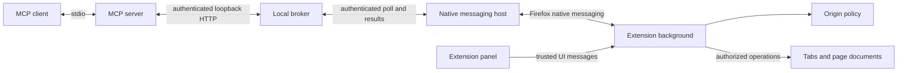

# Architecture

Firefox Bridge separates the MCP process, local broker, native messaging host, and Firefox extension. Browser capabilities and policy stay in the extension. The Node side manages transport and an internal local credential.

## Responsibilities

| Module | Responsibility |
| --- | --- |
| `src/contract.mjs` | Shared MCP catalog and strict argument validation |
| `src/mcp-server.mjs` | MCP tool/resource discovery and response formatting |
| `src/connection.mjs` | Broker startup, compatibility checks, and RPC client |
| `src/broker.mjs` | Authentication, extension ownership, bounded request routing, and uncertain-outcome handling |
| `src/runtime.mjs` | Runtime path, endpoint, and internal transport credential persistence |
| `src/native-host.mjs`, `src/native-protocol.mjs` | Native message framing, automatic broker connection, and correlated extension requests |
| `src/native-registration.mjs` | Per-user host manifests and launchers, restricted to the extension identifier |
| `src/background.mjs` | Extension connection loop and trusted panel-message dispatch |
| `src/controller.mjs` | Serialized operations, authorization, tab/frame lifecycle, and browser dispatch |
| `src/policy.mjs` | Origin normalization, permission decisions, expiring grants, and ticket invalidation |
| `src/page-operation.mjs` | Page observations, reference validation, and DOM interactions |
| `src/advanced.mjs` | Browser features, bounded file transfers, screenshots, and network metadata |
| `src/debugging.mjs`, `src/debug-page.mjs`, `src/console-page.mjs` | Fixed page instrumentation and bounded inspection/performance/console workflows |
| `src/panel.mjs`, `extension/panel.html`, `extension/panel.css` | Automatic connection status, user-controlled policy, optional capabilities, and transfer approval |
| `scripts/` | Build, setup, diagnostics, packaging, and isolated browser fixtures |

The shared contract is imported by the MCP server, broker, and extension so a request cannot gain acceptance solely by entering at a different boundary. Browser-facing helpers receive explicit dependencies rather than locating global runtime services.

## Request flow

1. The client submits a tool name and arguments through MCP.
2. The MCP process validates the call and sends an authenticated RPC to the loopback broker.
3. The native host polls the broker and forwards one correlated request over Firefox native messaging.
4. The controller serializes work, obtains capability tickets, and chooses the appropriate browser or page operation.
5. A page operation runs in the selected document. The controller verifies policy and document state before returning observations.
6. The broker routes the response to the original caller, and the MCP process formats structured text or image content.

The broker does not retry a delivered action. An uncertain completion remains visible to the client rather than being turned into a duplicate action.

## Page execution worlds

Ordinary page operations run as fixed extension-injected functions with access to the DOM and extension-owned observation state. They do not accept JavaScript source from the caller. Console capture uses a separate fixed recorder in the page's main world to observe future console calls and errors; that recorder is intentionally treated as page-controlled data, not a trusted command channel.

Keep instrumentation minimal and bounded. Debug collectors must not expose an extension messaging capability to page code or treat page-provided records as instructions. The [specification](spec.md#debug-lifecycle) defines cleanup and trust boundaries.

## Storage and lifecycle

Persistent extension storage holds connection identity, access policy, and the bounded operation audit. The Node runtime stores the internal transport credential outside the checkout. Observations, screenshots, pending work, and debug buffers are session data and are invalidated according to their owning lifecycle. Firefox starts the registered native host; reconnection is automatic and does not require a user-managed token.

Setup registers the host and replaces an authenticated incompatible Firefox Bridge broker when updating. It does not stop an unrelated service merely because it occupies the expected port. Reconnection after a broker restart restores the channel without replaying a delivered operation.

The extension profile owns authorization; the broker owns RPC delivery; the document owns element identity. Keeping these responsibilities separate prevents a transport reconnection from reviving a stale element or authorization ticket.

## Build and packaging

The source is JavaScript modules. esbuild bundles the extension background/panel and the Node MCP/broker/native-host entry points. Packaging includes those outputs and the source/documentation needed to review or rebuild them, along with generated third-party license notices. The packager verifies selected archive entries and excludes local state.

The extension and local runtime are installed separately. The runtime package contains compiled bundles and setup helpers so users can register the bridge without installing development dependencies. Source archives support reproducible builds; generated checksums identify the exact packaged files.

## Agent guidance

The root [`AGENTS.md`](../AGENTS.md) keeps always-needed rules short and points to this architecture and the specification only for relevant changes. Build/test commands, review constraints, and directory guidance follow OpenAI's [project instructions guidance](https://learn.chatgpt.com/docs/agent-configuration/agents-md). Runtime cross-tool guidance is provided separately through MCP server instructions, following [OpenAI's MCP guidance](https://developers.openai.com/codex/mcp#supported-mcp-features).
